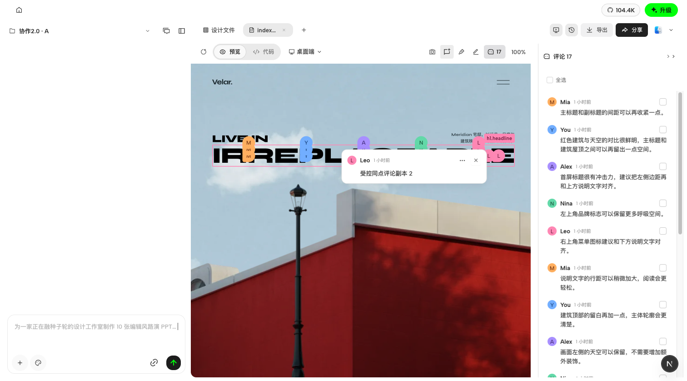
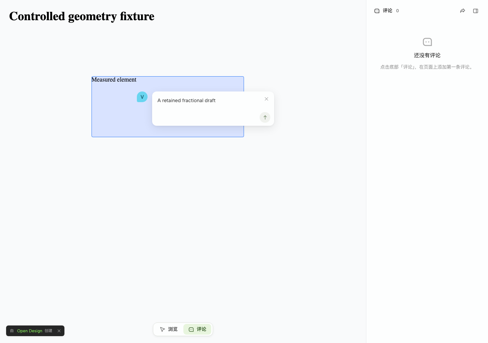
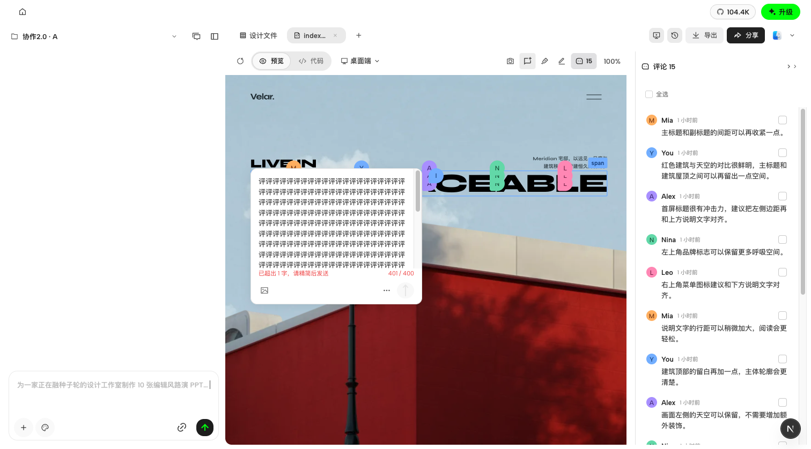
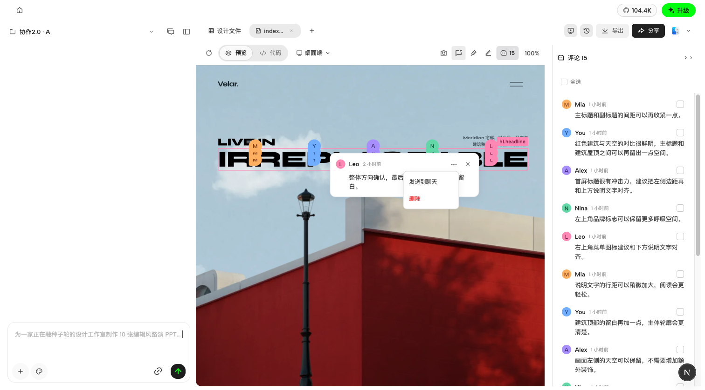
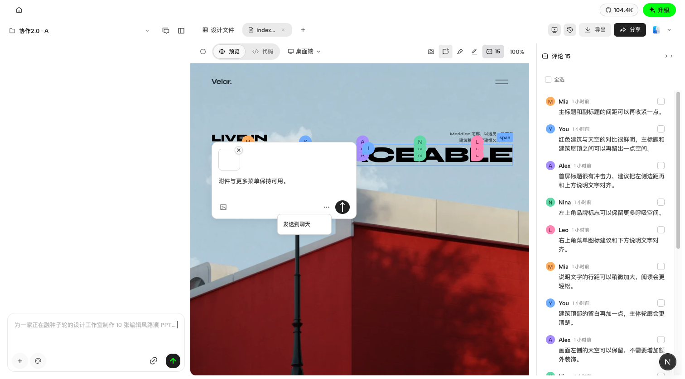

# 协作交互规则修复验收

2026-10-28；规则来源为飞书《协作评论通用交互原则》revision 13。按确认保留 authorKey hash 映射 30 色，不采用顺序分配。本记录只覆盖本轮修复；不是全部 30 条、真实 SSO、生产或跨设备验收。

|范围|客户端|网页 Viewer|
|---|---|---|
|CV03 身份色|既有 workspace context 带当前 authorKey；首次无历史评论及 seed 后到聚焦测试通过|光标、草稿头像、发送后图钉同色，受控浏览器通过|
|CV07–12 定位|浮层跟随实际簇内头像，12px 间隔、16px 安全区；不足空间隐藏保留输入节点|u/v 从选点、API、存储、读回及登录草稿完整传递；28px 图钉，安全区，宽度阶梯及内部滚动|
|CV13–15 悬停与草稿|150ms 等待、180/120ms 进入、200+100ms 退出；窄窗口保留同一 textarea、全文和选区|连续阅读、点击固定、草稿抑制、移动跟随和离屏隐藏；登录同版本重新定位，换版本保留正文提示手动重选；均不自动提交|
|CV17–19 堆叠与版本|实际簇内头像定位验证|同点最多5，不同 u/v 分开；离屏按原落点隐藏；旧版本说明渲染，虚化图钉保留|
|CV21–22 输入|长按 Enter repeat 不发送；既有400字限制|401保留全文禁发，删回400恢复；前后端按可见字符计数|
|CV25–27 文本与键盘|19种正文样本、双倍文案、240px压力无横溢；局部RTL、计数LTR；减少动效|19种文本样本、10个已支持locale挂载及fallback布局；真实Tab/Enter与减少动效通过|

## 实际截图与规则对照

客户端当前簇内头像到浮层实测12px；受控 GET 响应临时增加两条同点副本，未写API/DB，验收后撤回。

窄窗口隐藏再恢复：同一个输入节点、全文、选区[2,6]保留。

Viewer 真实浏览器运行产品组件，API/auth使用受控fixture；保存分数u/v、元素移动后更新真实矩形，发送前后点位与配色一致。

Viewer 280px 浮层，长文内部滚动，关闭和发送可达；不足160px时隐藏但保留正文。

## 验证证据

- 客户端：最终6个相关web文件67项通过；contracts两文件89项通过；workspace context daemon83项通过。根guard/typecheck通过。
- Vela：身份目录相关API65项、锚点API37项、读回/草稿27项、geometry/runtime42项，以及输入/版本/桥等聚焦测试通过。分组可能重叠，不累加总数；根lint包含workspace typecheck通过。
- Viewer最终浏览器：geometry5+草稿3共8项，hover/多语言/键盘7项通过。另400字/版本说明2项、旧401路径已验证；非全量回归。
- 审查与实屏发现后修复：首次lazy详情延迟、跨iframe离开事件关闭正在阅读的浮层、hover移动/离屏陈旧位置、客户端hover边界与隐藏卸载、浮层1px可用高度、协议生成回退完整首字符。

## 明确未验证的边界

- 客户端真实服务器的首次 authorKey seed 尚未部署联合实测；本地源代码、契约与组件回归通过，不能替代生产证明。
- Viewer登录续接使用受控401及认证完成跳转；真实IdP流程未验证。
- Viewer现有10个locale的分享译文存在fallback；19种正文压力测试不等于19套完整翻译验收。本轮未新增locale。
- 不改发布生命周期、同步队列、权限边界或数据库结构；逐条已读仍仅本地。旧ghost历史矩形模型未扩展为额外坐标迁移。
- CI需绑定推送后的新SHA单独检查；未合并、未部署。

## 评论浮层结构清理（2026-10-28 补验）

用户反馈旧式标题栏、拖拽柄和大按钮重新出现。本次直接删除草稿标题栏、拖拽状态及事件、查看全部评论入口；详情直接渲染作者、菜单和关闭按钮。评论组件自行提供完整样式，删除无调用的全局评论样式，保留元素参数预览及其他入口仍使用的共享样式。附件区增加留白，避免缩略图删除按钮被卡片裁切。

针对本次工作树：10个聚焦测试文件69项通过；FileViewer草稿与切换目标8项通过；根guard/typecheck通过。未跑全量套件。本次不改Vela、发布或同步逻辑。

浏览器使用本地隔离场景及受控评论数据，经冷加载和再次刷新验证：

- 草稿不含旧标题栏、拖拽柄和查看全部入口；详情只保留新头部。
- 400字可发送，401字禁发、保留全文并显示超出字数，无红色输入框。
- 窄窗隐藏再恢复，保留同一个输入节点、全文及选区[1,4]。
- 附件入口、删除按钮及更多菜单可达。附件采用透明1px图片fixture，仅证明容器与操作，不代表真实图片内容验收。
- 临时禁用评论CSS模块后，旧控件仍不存在；恢复样式后截图。无样式状态不是视觉验收结果。

截图与设计对比仅覆盖评论浮层；场景中的作者、评论内容、目标位置及背景画布尺寸不完全相同，不作为逐像素一致的证明。

