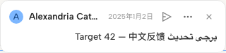
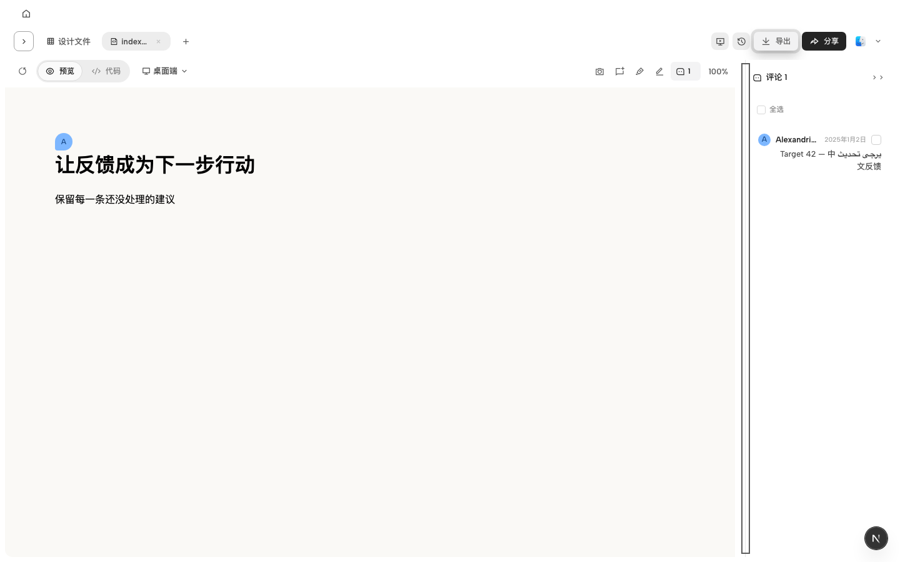
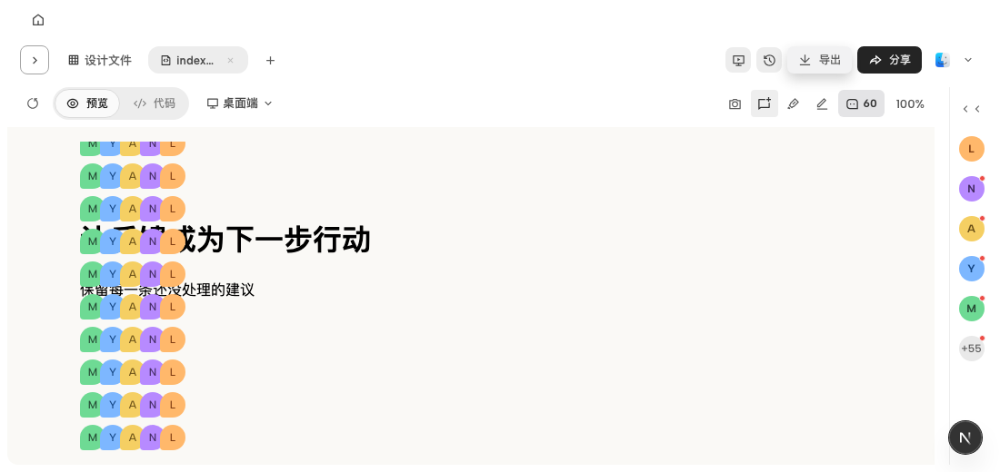
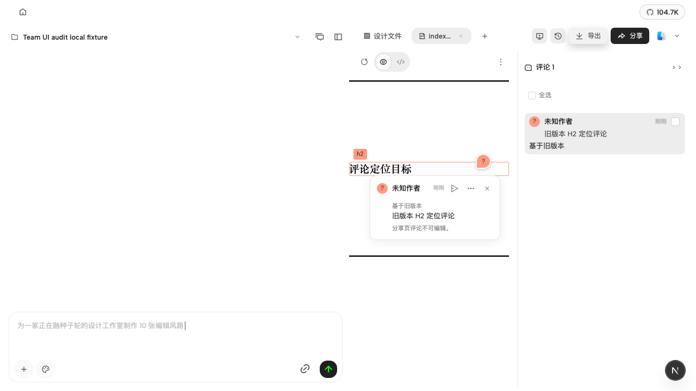

# 协作联合验收（2026-10-29）

## 范围与依赖

将客户端 #9101（2dac0c4c）与 #9122（96e527ef）、Vela #655（b224b284）与 #657（4bd67d1a）组合验收。
客户端基于 codex/share-phase1-acceptance（#9069），该前置 PR 保留；Vela 整合 PR 面向 main。
已纳入前置分支两端各两项后续修复：已读展示/浮层位置；预览恢复/重试预算。不新增服务协议或区域兜底。
保留原 30 位依次分配、31 位循环规则。10/28 客户端增量不扩展成新的 Viewer 产品需求。

## 串行整合

- 客户端同步测试同时保留换行规范化、嵌套路径 SQLite 持久化与重放去重。
- 定位浏览器测试同时保留 srcdoc/URL、团队/个人、嵌套缩放与裁切、读取失败保留评论及重试、目标删除后不误定位。
- 新设计使用一个已保存图钉表示选中态；测试验证选中前后位置一致与无重复草稿图钉，不继续要求旧双图钉结构。
- 嵌套夹具保存明确的元素内 u/v；旧左上角点在缩放后 x=-0.2 时按离屏规则应隐藏，不放宽产品边界。
- Vela bridge 同时保留嵌套文档监听清理、作者色、hover/草稿、禁用控件、closed details 和真实边界裁切。子窗口点击用局部矩形计算 u/v，投影只用于显示；被子窗口裁掉的点不画图钉。
- 两组 CI 入口均保留：客户端 project-workspace 与 project-workspace-editor；Vela qa-browser 的隔离/嵌套及评论交互步骤。

## 影响链与本地验证

| 改动边界 | 使用者 | 验证 |
| --- | --- | --- |
| 评论 DTO、u/v、400 字 | daemon / SQLite / CLI / web / Viewer | contracts 55；daemon 219；CLI wrapper 7；Vela API 256 |
| 原始文件服务、URL/srcdoc bridge、nested helper | FileViewer / powered preview / owner locate | runtime、组件、浏览器四种定位路径 |
| FileViewer / ProjectView / 弹层 / CSS / i18n | 侧栏、画布、独立发送、批量恢复 | web 36 文件 324 项；综合使用者 9 文件 468 项 |
| Vela runtime / ArtifactFrame / draft / placement | 隔离文档及嵌套文档 / 登录恢复 / hover / mobile | web 单元 447；隔离嵌套浏览器 4；评论浏览器首组 41 |
| suite 注册 / CI 命令 | CI planner 与 Playwright executor | 拓扑 95 通过、1 skipped；两端命令注册核对 |

客户端浏览器：交互规则 7 项、定位 4 项、原始发布锚点与取消恢复 2 项通过（分组记录，不重复计数）。
客户端 guard/typecheck 与 Vela lint/typecheck 通过。当前本地验证不代表远端 CI 已完成。

## 截图

完整参考设计对照在本次本地 .tmp/joint-acceptance/index.html。参考画布与受控夹具不同，不宣称整页像素一致。
嵌套截图的未知作者为未注入作者目录的夹具，不是线上用户身份验收。

## 证据边界

浏览器中的身份、云 API、Agent 响应存在受控夹具；本轮不宣称真实 IdP、线上 relay 或生产部署通过。
C07 部分拒绝/异常由原组件断言覆盖；浏览器验证子集接受和取消恢复。BYOK 预检原行为会跳转设置，未改动它来伪造原位拒绝截图，也未把接受后的运行失败称为提交拒绝。
关闭旧 PR 前需检查整合 PR 的当前提交 CI；不关闭 #9069 等前置 PR，不合并主分支。
