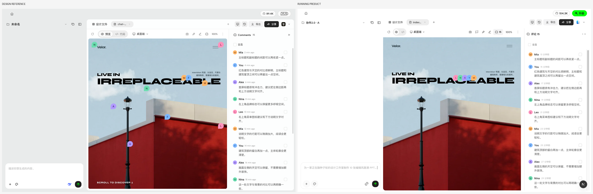
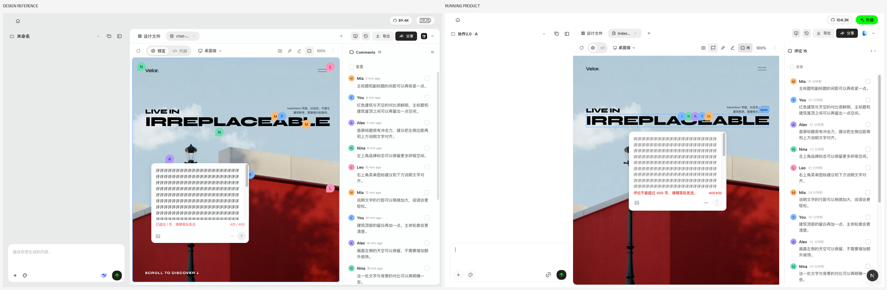
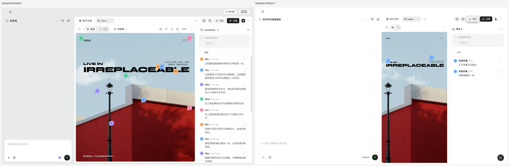

# Collaboration 2.0 client UI — OPEND-4408

This increment is based on the phase-one integration branch at `eb7ca6b734`; it must not merge the temporary integration branch into main. The approved scope is client comment browsing/input, canvas marker presentation, and batch/sync feedback, plus the already agreed exact anchor and 400-grapheme mainline changes.

## Scope review

Two independent reviews checked requirement coverage and implementation. No new publication lifecycle, workspace visibility rule, synchronization queue, authentication API, dependency, or database migration was added.

Four findings were corrected before submission:

- Saved Pod details no longer expose member removal or change the saved context through that control.
- Clearing or replacing a draft clears its save failure; saved details never show a previous draft's retry error.
- C originating in the preview iframe reaches the existing entry, with input/IME/modifier filtering and host-side active-frame source checks.
- Draft marker, target and cursor reuse the current member's known server-issued author color seed. No author key is synthesized from a name or member ID. Until that seed is available, the existing shared fallback remains; no new identity endpoint was introduced.

The manual synchronization notice uses the existing alignment endpoint. Its pending/failure/success state is local presentation state; it does not change synchronization success criteria or retries in the background.

## Visual evidence

Left: supplied design reference. Right: running product with synthetic comments. These are representative states, not a claim that all 84 catalog states were individually recaptured. Shell chrome, fixture identities, timestamps and anchor placement can differ. The screenshots were captured during visual acceptance. Subsequent review fixes have focused tests; CI follow-up also normalizes nine text-weight declarations from 400 to the existing 500 weight step, so these images predate that typography correction.

## Validation

- Scope/implementation review: completed, findings above corrected and independently rechecked.
- Review follow-up: 14 focused tests across composer, browse state, mainline and srcdoc bridge; 27 author identity tests; URL bridge shortcut/cursor test.
- Browser: iframe C → create → persist exact point → reload → read-only detail → selector resolution in original file bytes passed against a real local daemon.
- Earlier lane acceptance: A 46 tests; B 61 tests; C 28 tests and controlled-response browser retry/batch scenario. These groups overlap with follow-up checks and must not be summed as a unique total.
- Real local daemon Agent failure and cancellation restoration smoke passed before review; those business paths are unchanged by the review fixes.
- Root guard and typecheck passed. Full web/daemon suites were not run locally.

Cloud fault responses in the sync screenshot scenario are controlled fixtures. Personal-project browser creation currently yields structural `dom:` anchors; identity `cmt:` missing-target behavior is covered by focused tests, not by a fabricated identity in browser evidence. Per-comment read acknowledgement remains local; cross-device read synchronization is out of scope.

CI, merge, deployment and production verification are separate stages; no merge or deployment was performed for this change.

## CI follow-up

The first PR run exposed old UI expectations in the existing comment suites: the list button no longer enters creation mode, saved details are read-only, avatar markers replace the old pin presentation, and only opening an individual detail acknowledges it. Tests now use the approved interactions while retaining publication, source validation, persisted comment ordering, retry and Agent payload assertions. The local daemon still stores individual read acknowledgements; this is not a cross-device synchronization change.

Nine new CSS weight declarations now follow the existing typography ladder. A ShareTab test fixture now supplies the existing Workspace capabilities consumed by the sync banner. No publication or sync production logic changed in this follow-up.

- FileViewer: 352 tests passed.
- Share editing guards and ShareTab: 28 tests passed.
- Save boundaries and style contracts: 15 tests passed.
- Browser: comment save/reload/Agent follow-up artifact, adjacent comment attachment, and two-client publication/live content/presence/detail-read/unshare workflows passed.
- Root guard/typecheck, e2e typecheck and diff whitespace checks passed.
- The unrelated Pi process-close failure passed all five local cases and the same-commit CI job rerun; its runtime and tests were left unchanged.
- Vela companion #655 adds only ES2022.Intl to the Web type libraries to typecheck the approved grapheme counter; root lint/typecheck and 95 focused tests passed, and all remote checks passed on 183041dc1.
